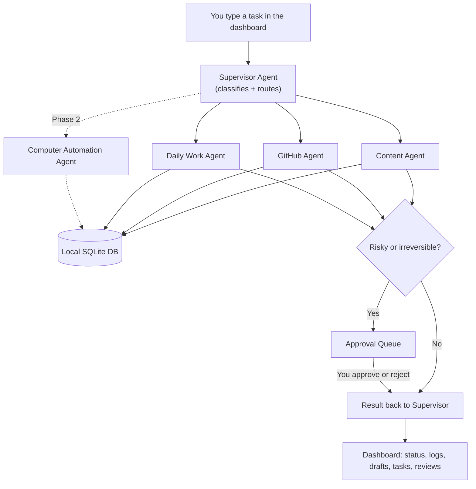

# Prince AI Team — Refined System Specification (v2)

**Status:** Authoritative Specification for Prince AI Team.

---

## 1. Goal, restated

A local-first, multi-agent assistant — **Prince AI Team** — that a Supervisor routes tasks to across four specialists (Content, GitHub, Daily Work, Computer Automation), backed by persistent local storage, full logging, and a hard approval gate on anything risky or irreversible. You review and approve; the agents don't act unsupervised.

### Guiding principles
- Free/open-source first; local models preferred; paid APIs only where genuinely unavoidable.
- Swappable AI backend — the model is a config value, never hardwired into agent logic.
- Persistent local database, not in-memory state.
- Every agent action logged.
- Approval required before anything risky or irreversible.
- No secrets in source code; `.env` + `.env.example` + `.gitignore`.
- Simple enough for a beginner to clone and run.

---

## 2. Architecture overview



Routing mechanics:
- Cheap keyword/intent pass first to shortlist candidate agents (instant, no LLM call).
- Small LLM call to confirm shortlist and extract sub-instructions.
- Chained context passed forward as structured data (e.g. GitHub review -> Content Agent).
- Final response is a short executive synthesis with links to full detail.

---

## 3. Key architecture decisions

| Area | Chosen | Why |
|---|---|---|
| Orchestration | Custom lightweight Python router (no heavy framework) | Fully transparent and debuggable; simple Plain Python classes. |
| LLM backend | Pluggable `LLMProvider` interface; Ollama as free default, optional Anthropic API adapter | Modular, swappable per-agent via `.env`. |
| Default local model | Qwen3 or Llama 3.3 / Llama 3.2 via Ollama | Native tool-calling support, zero API costs. |
| Dashboard | Single **FastAPI** app serving a server-rendered **Jinja2 + HTMX** dashboard | One process, `uvicorn main:app`, no Node/React build step, real-time HTMX polling. |
| Database | **SQLite + SQLAlchemy** | Zero setup, single file in `data/prince_ai_team.db`, declarative models. |
| Scheduling | **APScheduler**, in-process, for MVP | In-app reminders. OS notifications in Phase 2. |
| Secrets | `.env` via `python-dotenv`, committed `.env.example`, `.gitignore` | Standard security hygiene. |

---

## 4. Repository structure

```
prince-ai-team/
├── .env.example
├── .gitignore
├── README.md
├── requirements.txt
├── main.py                    # FastAPI entrypoint
├── config.py                  # loads .env, central settings
├── db/
│   ├── models.py               # SQLAlchemy models (§5)
│   └── session.py
├── llm/
│   ├── base.py                  # LLMProvider abstract interface
│   ├── ollama_provider.py       # default, free
│   └── anthropic_provider.py    # optional fallback
├── agents/
│   ├── supervisor.py
│   ├── content_agent.py
│   ├── github_agent.py
│   ├── daily_work_agent.py
│   └── automation_agent.py     # Phase 2 stub — interface only for now
├── approvals/
│   └── manager.py               # approval queue logic (§11)
├── logging_utils/
│   └── logger.py
├── dashboard/
│   ├── templates/                # Jinja2
│   └── static/
├── data/                         # prince_ai_team.db lives here (gitignored)
└── tests/
    ├── test_supervisor.py
    ├── test_content_agent.py
    └── test_github_agent.py
```

---

## 5. Data model

| Table | Purpose | Key fields |
|---|---|---|
| `tasks` | What you asked for, and its lifecycle | id, raw_input, routed_agents, status, created_at, completed_at |
| `agent_runs` | One row per agent invocation — the audit trail | id, task_id, agent_name, input, output, status, started_at, finished_at |
| `drafts` | Every Content Agent output | id, platform (linkedin/medium/x), type (original/reply), status (draft/approved/rejected/posted_manually/posted_via_api), content, source_ref, created_at |
| `github_reviews` | GitHub Agent's structured reports | id, repo, summary_json, human_summary, created_at |
| `work_items` | Daily Work Agent's tasks/subtasks | id, title, project_tag (gate_prep/ai_ml/github/content), parent_id, status, priority, due_date, created_at, completed_at |
| `reminders` | In-app reminders | id, work_item_id, remind_at, fired (bool), created_at |
| `approvals` | The single gate every risky action passes through | id, action_type, description, payload_json, requested_by_agent, status (pending/approved/rejected), created_at, resolved_at |
| `logs` | Structured log of everything, mirrored to log file | id, agent_name, level, message, created_at |

---

## 6. Supervisor Agent
- Keyword + LLM routing pass.
- Structured context chaining.
- Computer Automation Agent is registered as "not implemented yet" in MVP.

---

## 7. Content Agent
- **Original posts:** 6-part structure (hook, context, explanation, personal take, forward implication, closing question). Outputs: LinkedIn + expanded Medium + condensed X + optional cover image prompt.
- **Reply/comment pipeline:** Analyzes target post, verifies claims, 1 non-obvious angle, up to 3 ranked options, strict bans on generic praise, generic summaries, forced questions, hashtags, decorative emoji.
- All outputs saved as drafts. Never auto-published.

---

## 8. GitHub Agent
- Read-only for MVP. Scrapes repo tree, README, tests dir, CI config, deps manifests, layout.
- Stores JSON report + human summary in `github_reviews`.

---

## 9. Daily Work Agent
- `work_items` with tasks/subtasks, tagged by project (`gate_prep`, `ai_ml`, `github`, `content`).
- Goal breakdown into actionable child rows.
- In-app reminders only.

---

## 10. Computer Automation Agent
- Deferred to Phase 2. Supervisor routing table marks it "not implemented yet".

---

## 11. Approval & Safety Workflow
- Dedicated gate `approvals/manager.py` with `approvals` table.
- Always gated: sending messages, publishing content, deleting files, purchasing, changing system settings, GitHub write actions.
- Agents write to `approvals` and pause until user confirms.

---

## 12. Security & Secrets
- `.env` via `python-dotenv`, committed `.env.example`, `.gitignore`.

---

## 13. Dashboard
- Single FastAPI app serving Jinja2 + HTMX templates.
- Endpoints:
  - `/` Home (task input, routing visualization, HTMX live status polling, inline results)
  - `/tasks` Task history
  - `/drafts` Saved drafts (LinkedIn/Medium/X)
  - `/work` Daily work items & reminders
  - `/github` Repo reviews
  - `/approvals` Pending approvals with approve/reject actions
  - `/logs` Agent activity logs

---

## 14. Logging
- Python structured logging to rotating file + mirrored in `logs` table.

---

## 15. MVP Definition of Done
- Supervisor routes correctly.
- Content Agent handles original post & reply drafting pipelines.
- GitHub Agent audits `p4prince2` repos.
- Daily Work Agent creates, decomposes, tracks `work_items`.
- Approval queue blocks risky actions until approved.
- FastAPI + HTMX dashboard runs with `uvicorn main:app`.
- 100% local model (Ollama) out of the box with zero paid API requirement.
